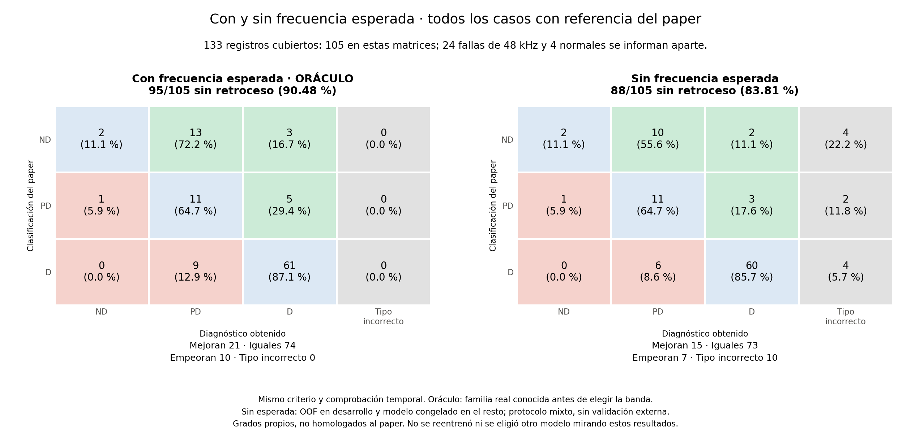

> **Revisión metodológica del 16 de noviembre de 2026:** excluyendo el tipo y tamaño completos —incluidas todas las posiciones OR, cargas, sensores y muestreos— el ensayo de tres vistas temporales de selección obtiene **84/105 sin retroceso**: 14 mejoras, 70 iguales, 4 descensos y 17 tipos incorrectos (**21 desfavorables**). Frente al ensayo anterior de 82/105, recupera 4 casos y pierde 2. La meta de **100/105**, con muchas más mejoras que resultados desfavorables, sigue pendiente. Se conservan los 133 archivos en la evaluación y el corpus de 52 archivos con falla para desarrollo; cada ajuste excluye su grupo evaluado. Las doce vistas por archivo son correlacionadas, no casos independientes. Los resultados históricos de 88/105 usaban una agrupación menos estricta. Véanse el [balance de ensayos](05_Diagnostico_Ciego/revision_meta_100/INFORME.md), el [informe temporal](05_Diagnostico_Ciego/resultados_temporales_acp/INFORME.md) y su [verificación](05_Diagnostico_Ciego/resultados_temporales_acp/verificacion.json). Todo sigue siendo exploratorio, sin validación externa; los modelos históricos no se han reemplazado.

# Diagnóstico de rodamientos con CWRU

> **Límite del selector:** la [auditoría con verificación](05_Diagnostico_Ciego/auditoria_cota_verificada/INFORME.md) sitúa la cota de los selectores de 31 y 63 bandas en **97/105**, y la del banco57 en **99/105**, incluso con identificación del tipo perfecta. Son límites de esos selectores, no resultados de un modelo ciego. Alcanzar 100 requiere resolver también la selección de bandas.

Proyecto de detección de anomalías de PUCV, segundo semestre de 2026.
Estudia MFD, kurtogram, entropía, estabilidad temporal y clasificación de fallas
de rodamientos. Incluye código, modelos numéricos, figuras, resultados y auditorías.

## Última prueba de clasificación del tipo

El foco actual es reducir a **5** los errores de tipo entre los mismos **105**
registros con referencia del paper. Se autorizó ampliar el corpus de entrenamiento
a los **128 archivos con falla y longitud suficiente**, excluyendo en cada ajuste
el grupo completo de tipo y tamaño: todas sus posiciones OR, cargas, sensores y
frecuencias de muestreo. El detector se mantuvo fijo para aislar el cambio en el
clasificador de tipo.

| Entrenamiento ampliado | Tipos incorrectos / 105 | Tipos incorrectos / 133 |
| --- | ---: | ---: |
| Con controles D/PD | 17 | 22 |
| Sin controles | 21 | 25 |

La meta sigue pendiente. Estas ejecuciones solo evaluaron el tipo, sin recalcular
los grados D/PD/ND, y **todavía requieren auditoría independiente**. No sustituyen
la referencia auditada de 84/105 indicada arriba ni constituyen validación externa.
El archivo corto permanece en la evaluación como sin diagnóstico.

Se incluyen [predicciones y errores con controles](05_Diagnostico_Ciego/resultados_tipo_completo_control/)
y [sin controles](05_Diagnostico_Ciego/resultados_tipo_completo_sin_control/),
con los archivos exactos de entrenamiento de cada grupo en `pliegues.json`.
Los datos MATLAB originales y los puntos de reanudación `progreso.*` se conservan
localmente; se publican código, rasgos calculados, resultados y auditorías.

## Resultados históricos y reproducción

La última comparación cubre **133 registros**. Las matrices de cambios frente al
paper incluyen los **105 registros de 12 kHz con referencia transcrita**:

| Escenario | Mejoran | Mantienen | Empeoran | Tipo incorrecto | Sin retroceso |
| --- | ---: | ---: | ---: | ---: | ---: |
| Con familia/frecuencia esperada: oráculo | 21 | 74 | 10 | 0 | 95/105 (90,48 %) |
| Sin frecuencia esperada | 15 | 73 | 7 | 10 | 88/105 (83,81 %) |



Las otras señales se informan separadamente: **21/24 tipos correctos a 48 kHz**
y **4/4 normales identificados** sin frecuencia esperada. Una señal de 48 kHz
no alcanza la duración mínima de cinco segundos y queda como sin diagnóstico;
no se elimina del denominador.

El oráculo recibe deliberadamente la familia verdadera antes de elegir la banda.
El método ciego recibe señal, frecuencia de muestreo y catálogo completo del
rodamiento, sin indicar cuál es la falla real. La banda se elige en la primera
mitad y se comprueba en la segunda.

**Estos números no son validación externa.** Se conservan predicciones fuera de
grupo en desarrollo y se aplica un modelo congelado al resto, con condiciones
compartidas. Los grados ND/PD/D siguen reglas propias y no están homologados
con la rúbrica del paper. La meta de al menos 90/105 sin retroceso **sin oráculo**
todavía no se alcanza.

Resultados por registro: [comparacion_133.csv](05_Diagnostico_Ciego/comparacion_con_sin_esperada_todos/comparacion_133.csv).

## Instalación

Python 3.11 o posterior; el entorno original usa Python 3.13.

```shell
python -m venv .venv
python -m pip install -r requirements.txt
```

Active el entorno virtual antes de instalar o ejecutar. Jupyter es opcional
para los notebooks históricos: `python -m pip install jupyter`.

## Datos originales

Los archivos MATLAB del dataset, aproximadamente 536 MB incluyendo copias de
verificación, no se suben a Git. Sí se incluyen índices y registros de procedencia.
Descargue los datos del [Bearing Data Center de CWRU](https://engineering.case.edu/bearingdatacenter/download-data-file)
y ubíquelos en estas rutas, respetando los nombres de `indice_canal_verificado.csv`:

```text
data2/CWRU/
  12k_DE/    # 60 archivos
  12k_FE/    # 45 archivos
  48k_DE/    # 24 archivos
  Normal/    # 4 archivos
```

Fuentes: [12 kHz DE](https://engineering.case.edu/bearingdatacenter/12k-drive-end-bearing-fault-data),
[12 kHz FE](https://engineering.case.edu/bearingdatacenter/12k-fan-end-bearing-fault-data),
[48 kHz DE](https://engineering.case.edu/bearingdatacenter/48k-drive-end-bearing-fault-data),
[normales](https://engineering.case.edu/bearingdatacenter/normal-baseline-data).

Algunos MAT contienen varios registros. **No seleccione la primera variable
que termine en `_DE_time` o `_FE_time`.** El lector corregido selecciona el
registro explícito y sus RPM correspondientes. El índice verificado conserva
133 señales distintas. Los identificadores internos pueden repetirse entre
archivos: la ruta también identifica la adquisición.

## Reproducir la comparación actual

Desde la raíz, después de disponer de los datos:

```shell
python 05_Diagnostico_Ciego/evaluar_comparacion_todos.py
python 05_Diagnostico_Ciego/verificar_comparacion_todos.py
```

No se reentrena ni se elige otro modelo mirando el total. Se emplean el modelo
de tipo en `resultados_jerarquico/` y los detectores DE/FE en
`resultados_por_dominio/`, dentro de `05_Diagnostico_Ciego/`.

Prueba del lector contra las copias descargadas de la fuente oficial:

```shell
python 05_Diagnostico_Ciego/recuperar_fuentes_cwru.py
python 05_Diagnostico_Ciego/test_selector_mat.py
```

`.gitattributes` conserva los bytes de los archivos porque los modelos verifican
hashes de código y artefactos. No normalice sus saltos de línea sin regenerar
los modelos y los manifiestos correspondientes.

## Organización e historial

| Carpeta | Contenido |
| --- | --- |
| `01_MFD_Kurtogram_Tarea1` | MFD, kurtogram y envolvente espectral |
| `02_Sinergia_Fraterna` | Métrica de estructura padre/hijos del árbol |
| `03_Comparacion_Kurtogram_vs_Sinergia` | Comparación histórica de métodos |
| `04_Comparacion_Kurtogram_vs_Entropia` | Entropía, filtros, doble banda y estabilidad |
| `05_Diagnostico_Ciego` | Inferencia sin frecuencia esperada, experimentos y auditorías |

Se conservan resultados y pesos históricos para trazabilidad; no todos son
entradas vigentes. Algunos pesos anteriores están invalidados por las correcciones
de lectura y no deben usarse como resultados actuales. Las rutas de los primeros
experimentos pueden diferir: consulte sus instrucciones específicas y
[README_historico.md](README_historico.md).

Auditorías principales:

- [Selección de registros y RPM en MAT](05_Diagnostico_Ciego/auditoria_selector_mat/INFORME.md).
- [Auditoría de los modelos y criterios diagnósticos](05_Diagnostico_Ciego/auditoria_modelos_actuales/INFORME.md).
- [Protocolo de mejoras reales](05_Diagnostico_Ciego/PROTOCOLO_MEJORAS_REALES.md).
